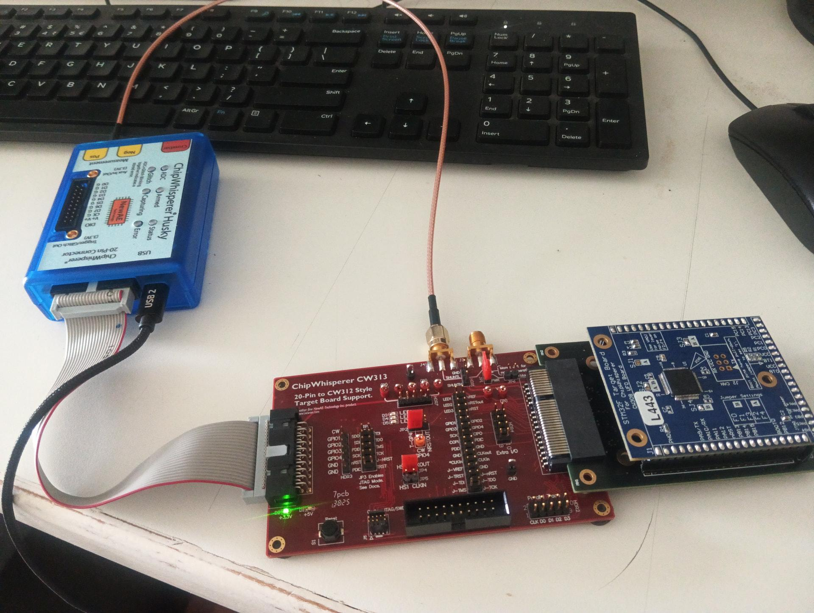
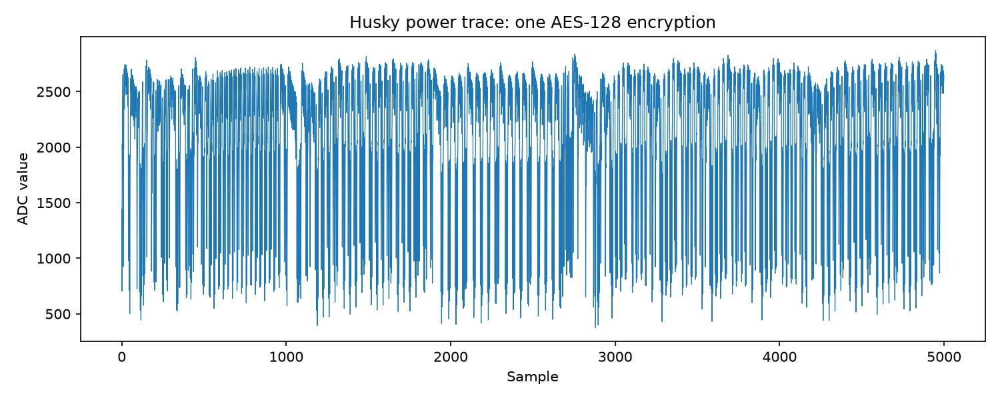

# ChipWhisperer Setup on macOS

Set up a NewAE ChipWhisperer-Husky on an Apple Silicon Mac (M1/M2/M3), then capture a first AES power trace from the SAM4S target in the Husky kit.

| Term            | Meaning                                                      |
| --------------- | ------------------------------------------------------------ |
| Husky           | Capture device. Powers the target and measures its power use |
| Target          | SAM4S chip on the CW313 board                                |
| Husky firmware  | Program on the Husky itself. Ships with it                   |
| Target firmware | AES program flashed onto the SAM4S                           |
| Trace           | Power measurements recorded during one run                   |

## Tested with

| Item              | Version                   |
| ----------------- | ------------------------- |
| Mac               | MacBook Air M1            |
| macOS             | 26.3.1                    |
| ChipWhisperer     | `v6.1.0` (git tag)        |
| Husky firmware    | 1.5.0                     |
| Python            | 3.11 (Miniforge, `arm64`) |
| GNU Make          | 4.4.1                     |
| arm-none-eabi-gcc | 15.3.1                    |
| libusb            | 1.0.30                    |

## Contents

1. [Requirements](#1-requirements)
2. [Install system tools](#2-install-system-tools)
3. [Install Python](#3-install-python)
4. [Install ChipWhisperer](#4-install-chipwhisperer)
5. [Connect the hardware](#5-connect-the-hardware)
6. [Test 1: Connect to the Husky](#6-test-1-connect-to-the-husky)
7. [Test 2: Build and flash target firmware](#7-test-2-build-and-flash-target-firmware)
8. [Test 3: Capture a power trace](#8-test-3-capture-a-power-trace)
9. [Jupyter tutorials](#9-jupyter-tutorials)
10. [Help](#10-help)

## 1. Requirements

**Hardware (Husky kit)**

- ChipWhisperer-Husky
- USB-C to USB-C cable
- SMA female to SMA female cable
- 20-pin cable
- CW313 target base-board
- SAM4S ARM target board (CW312T-SAM4S)

**Software**

- Homebrew, Apple Silicon build. `which brew` must print `/opt/homebrew/bin/brew`.
- zsh, the default macOS shell.

Full kit list: NewAE's [Husky Starter Kit page](https://chipwhisperer.readthedocs.io/en/latest/Starter%20Kits/ChipWhisperer-Husky.html). Target details: [CW312T-SAM4S datasheet](https://media.newae.com/datasheets/NAE-CW312T-SAM4S_datasheet.pdf).

## 2. Install system tools

```bash
brew install libusb make
brew install --cask gcc-arm-embedded
```

| Package            | Recommended version | Purpose                                             |
| ------------------ | ------------------- | --------------------------------------------------- |
| `libusb`           | 1.0.x, `arm64`      | USB communication between Python and the Husky      |
| `make`             | GNU Make 4.x        | Firmware builds. macOS ships 3.81, which is too old |
| `gcc-arm-embedded` | 13.2 or newer       | ARM compiler for the SAM4S target                   |

Use GNU Make as the default `make`:

```bash
echo 'export PATH="$(brew --prefix make)/libexec/gnubin:$PATH"' >> ~/.zshrc
source ~/.zshrc
```

Verify:

```bash
make --version
arm-none-eabi-gcc --version
```

`make --version` must report GNU Make 4.x.

`avr-gcc` is only needed for XMEGA/AVR targets and is not required for the Husky kit.

NewAE's [macOS installation guide](https://chipwhisperer.readthedocs.io/en/latest/mac-install.html) covers these packages, including the AVR compiler for older targets.

## 3. Install Python

ChipWhisperer `v6.1.0` requires Python 3.11 or newer. Python and libusb must both be `arm64`. NewAE recommends Miniforge, which installs `arm64` Python and `conda`.

```bash
brew install --cask miniforge
conda init zsh
```

Open a new terminal, then create the environment:

```bash
conda create -n cw python=3.11 -y
conda activate cw
```

Verify both are `arm64`:

```bash
python -c "import platform; print(platform.machine())"
file $(brew --prefix libusb)/lib/libusb-1.0.dylib
```

> [!WARNING]
> If Python reports `x86_64`, the terminal is running under Rosetta. In Finder, open **Get Info** on the terminal app and untick **Open using Rosetta**.

> [!IMPORTANT]
> Run `conda activate cw` in every new terminal before using ChipWhisperer.

The "Mac M1 Notes" in NewAE's [macOS installation guide](https://chipwhisperer.readthedocs.io/en/latest/mac-install.html) and issue [#381](https://github.com/newaetech/chipwhisperer/issues/381) explain the `arm64` requirement.

## 4. Install ChipWhisperer

Clone ChipWhisperer into this project:

```bash
git clone https://github.com/newaetech/chipwhisperer
cd chipwhisperer
git checkout v6.1.0
git submodule update --init jupyter
python -m pip install -e .
python -m pip install -r jupyter/requirements.txt
```

`v6.1.0` matches Husky firmware 1.5.0. The default `develop` branch expects firmware 1.7.0. With firmware 1.5.0, `cw.scope()` then fails with:

```
Your firmware (1.5.0) is outdated - latest is 1.7.0
OSError: [Errno FPGA Done pin failed to go high, bad bitstream?]
```

If this happens, run `git checkout v6.1.0` and `python -m pip install -e .`. Then unplug USB and all target cables, and reconnect only USB.

`pip install -e .` also installs ChipWhisperer's dependencies, including `pycryptodome`, the AES library used in Test 3.

The `udev` and `usermod` steps in the Linux guide are Linux-only. Skip them on macOS.

Verify:

```bash
python -c "import chipwhisperer as cw; print(cw.__version__)"
```

On `v6.1.0` this prints `6.0.0`.

These commands follow NewAE's [Linux installation guide](https://chipwhisperer.readthedocs.io/en/latest/linux-install.html), which the macOS guide points to for this step.

## 5. Connect the hardware

Keep USB unplugged until the last step.

1. Seat the **SAM4S target** in the target socket on the **CW313** base-board.
2. Connect the **20-pin cable** from the Husky **20-pin connector** to the CW313 20-pin header. It carries power, clock, serial and trigger.
3. Connect the **SMA cable** from the Husky **Measure POS** port to the CW313 SMA connector. It carries the power signal. Finger-tight is enough.
4. **Measure NEG**: fit the short-circuit cap if the kit includes one. Otherwise leave it empty.
5. Leave the **Glitch** port and both **MCX** ports empty.
6. Connect the **USB-C cable** from the Husky to the Mac. The Husky powers the target. No external supply is needed.



> [!WARNING]
> Misuse of the Glitch port can damage the Husky's glitch MOSFETs. Leave it unconnected for these tests.

Verify that macOS detects the Husky:

```bash
system_profiler SPUSBHostDataType | grep -i -A 10 husky
```

Expected: `USB Vendor ID: 0x2b3e`, `USB Product ID: 0xace5`. On older macOS versions, use `SPUSBDataType`.

NewAE's [Husky hardware page](https://chipwhisperer.readthedocs.io/en/latest/Capture/ChipWhisperer-Husky.html) describes every port and the 20-pin pinout.

## 6. Test 1: Connect to the Husky

The tests are scripts in `scripts/`. Each prints `PASS` (exit code 0) or `FAIL` with the reason (exit code 1).

| Script                        | Test                                                        |
| ----------------------------- | ----------------------------------------------------------- |
| `scripts/check_connection.py` | Connects to the Husky, prints firmware version and settings |
| `scripts/flash_target.py`     | Flashes the AES firmware onto the SAM4S target              |
| `scripts/capture_trace.py`    | Captures one AES trace, checks the result, plots it         |

The scripts expect ChipWhisperer in `chipwhisperer/` in this project, as cloned in section 4. Otherwise set its location:

```bash
export CHIPWHISPERER_DIR=/path/to/chipwhisperer
```

Run Test 1:

```bash
conda activate cw
python scripts/check_connection.py
```

Expected: `Husky firmware: 1.5.0`, a full dump of the Husky settings, and `PASS: Husky connected`.

> [!IMPORTANT]
> Only one process can use the Husky at a time. Close other Python sessions or notebooks first.

The [Scope API reference](https://chipwhisperer.readthedocs.io/en/latest/scope-api.html) explains every setting in the dump.

## 7. Test 2: Build and flash target firmware

Build the AES firmware for the SAM4S target:

```bash
conda activate cw
make -C chipwhisperer/firmware/mcu/simpleserial-aes PLATFORM=CWHUSKY CRYPTO_TARGET=TINYAES128C SS_VER=SS_VER_1_1
```

Expected: `Built for platform CW-Husky Microchip SAM4S`, and a new file `simpleserial-aes-CWHUSKY.hex`.

| Option                      | Meaning                                                |
| --------------------------- | ------------------------------------------------------ |
| `PLATFORM=CWHUSKY`          | SAM4S target in the Husky kit                          |
| `CRYPTO_TARGET=TINYAES128C` | tinyAES, a small AES-128 library in C                  |
| `SS_VER=SS_VER_1_1`         | SimpleSerial v1.1, the Husky-to-target serial protocol |

`CW308_SAM4S` builds the same code but is deprecated.

Flash it:

```bash
python scripts/flash_target.py
```

Expected: `PASS: flashed simpleserial-aes-CWHUSKY.hex`. The Husky flashes the SAM4S over the 20-pin cable and verifies it.

The firmware stays on the SAM4S after power-off.

For other target boards, see the `PLATFORM` list in `firmware/mcu/hal/Makefile.hal` in the ChipWhisperer repo.

## 8. Test 3: Capture a power trace

```bash
python scripts/capture_trace.py
```

Expected:

```
Samples captured: 5000
Ciphertext: <16 bytes in hex>
PASS: AES result correct
```

How the check works:

1. The SAM4S encrypts a random 16-byte plaintext with the fixed key `2B7E151628AED2A6ABF7158809CF4F3C` (the FIPS-197 example key), using tinyAES. The Husky records the power trace meanwhile.
2. The Mac encrypts the same plaintext and key with `pycryptodome`, installed in section 4.
3. AES is deterministic, so both ciphertexts must match. A match means the target firmware works.

If the script fails with `Device failed to ack`, the target is not running the AES firmware. Run `python scripts/flash_target.py` again, then retry.

A plot of the trace then opens. The repeating blocks are the 10 AES rounds. The script ends when the plot is closed.



The [Scope API reference](https://chipwhisperer.readthedocs.io/en/latest/scope-api.html) covers capture settings such as sample count and gain.

## 9. Jupyter tutorials

Make sure no script or Python session is connected to the Husky. Then start Jupyter in the browser:

```bash
conda activate cw
cd chipwhisperer
jupyter notebook
```

In the `jupyter` folder:

1. Run `Test Connection.ipynb`. Expected output: a line starting with `INFO: Found ChipWhisperer`.
2. Work through `Lab 1` to `Lab 10` in order. These are the SCA101 labs for the Husky.

The labs already use `PLATFORM=CWHUSKY` and `SS_VER_1_1`. Run `scope.dis()` at the end of each notebook before opening the next.

Lab solutions are in the [chipwhisperer-jupyter repository](https://github.com/newaetech/chipwhisperer-jupyter). Theory and walkthroughs are in NewAE's [SCA101 course](https://learn.chipwhisperer.io/courses/sca101).

## 10. Help

For errors not covered here, search the [NewAE Forum](https://forum.newae.com/).
